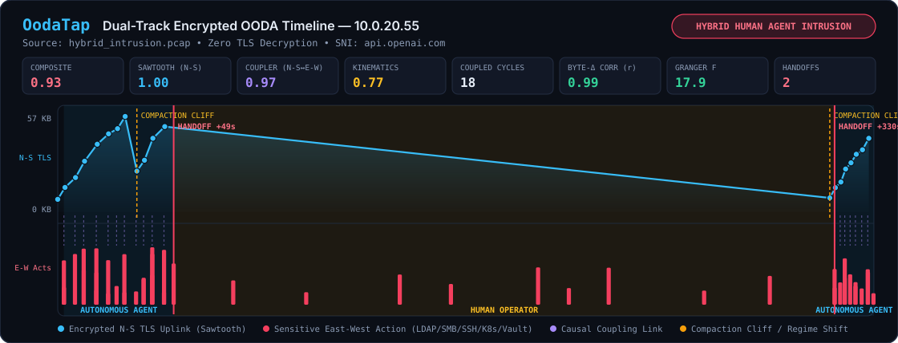

# OodaTap

[](https://github.com/ejames-dev/OodaTap/actions/workflows/ci.yml)
[](https://github.com/ejames-dev/OodaTap/blob/main/pyproject.toml)
[](LICENSE)

> **Passive network detection for autonomous and hybrid human+agentic OODA loops — without decrypting TLS.**

Modern threat actors increasingly operate **side-by-side with agentic systems**: an autonomous reasoning loop performs rapid enumeration, lateral discovery, and hypothesis testing, then hands off high-value findings to a human operator (or resumes post-exploitation sweeps).

Traditional network detection misses this hybrid threat:
- **Signature / payload IDS** misses living-off-the-land commands and encrypted TLS traffic.
- **Classic C2 beacon detectors** look for periodic jitter, whereas an LLM-backed agent is **event-driven by tool outputs and inference latency**.
- **Prompt firewalls** only inspect *your own* AI apps — not a rogue offensive agent running on a compromised host and "living off trusted AI APIs" (`api.anthropic.com`, `api.openai.com`, Bedrock, OpenRouter, or self-hosted vLLM/Ollama).

**OodaTap** detects **cognition-over-the-wire** strictly from passive network telemetry (`.pcap`, `.pcapng`, Zeek `conn.log`/`ssl.log`, Suricata `eve.json`, or normalized JSONL).



---

## How It Works

```text
[ .pcap / .pcapng ] / [ Zeek conn.log + ssl.log ] / [ Suricata eve.json ] / [ Future eBPF ]
                                     │
                                     ▼  (Normalized Burst & Action JSONL)
                        ┌─────────────────────────┐
                        │  1. Sawtooth Detector   │  Monotonic uplink growth + compaction
                        │     (North-South TLS)   │  cliffs + SSE streaming cadence
                        ├─────────────────────────┤
                        │  2. Cross-Flow Coupler  │  E-W response size <-> N-S uplink delta
                        │     (N-S <-> E-W)       │  lag correlation + OLS Granger F-test
                        ├─────────────────────────┤
                        │  3. Session Kinematics  │  Parallel tool fan-out + BIC optimal-part.
                        │     & Handoff Detector  │  change-points (Agent <-> Human shifts)
                        └─────────────────────────┘
                                     │
                                     ▼
          [ Policy & Dev-Agent Allowlist ] ──▶ [ Rich CLI | ECS JSONL | Offline HTML Timeline ]
```

### Three Interlocking Signals
1. **Context-Growth Sawtooth (North-South TLS):** Multi-turn agents append tool outputs to their prompt history, producing a monotonic uplink staircase punctuated by sharp **context-compaction cliffs**, paired with small-record SSE token streaming on the downlink.
2. **Cross-Flow Causal Coupling (North-South ↔ East-West):** Even under AES-256-GCM TLS 1.3 encryption, an actively driving agent exhibits tight phase-locked coupling: internal East-West responses (`bytes_in` from SMB, LDAP, SSH, K8s API, WinRM, Postgres) are followed within milliseconds by an encrypted uplink burst whose **byte delta correlates with the internal response volume**, followed after inference by sub-second dispatch of the next East-West probe—verified with an **OLS Granger-causality F-test**.
3. **Session Kinematics & Human↔Agent Handoffs:** Clusters simultaneous parallel tool-call fan-outs and runs **BIC-penalized L2 optimal partitioning (dynamic programming)** over inter-action timing to distinguish classic scripted scanners, autonomous agents, and human operators—flagging exact timestamps when an intrusion transitions between autonomous agent control and manual human exploitation (including non-monotonic `Agent → Human → Agent` handoffs).

### Built-In False-Positive Control (Benign Coding Agents)
Developers legitimately run coding agents (Claude Code, Cursor, etc.) that *also* produce real OODA sawtooths. `OodaTap` ships with a declarative YAML policy ([`policies/default_policy.yaml`](policies/default_policy.yaml)) that distinguishes developer loops coupled strictly to `localhost` / allowlisted git & dev servers (`benign_dev_agent`) from loops coupled to sensitive East-West lateral protocols (`SMB`, `LDAP`, `SSH`, `K8s`, `WinRM`, `Vault`, internal DBs).

---

## Quickstart

Requires **Python 3.11+** and [`uv`](https://docs.astral.sh/uv/).

```bash
# Install dependencies
uv sync --dev

# Analyze a noisy 5-host enterprise .pcapng (isolates 2 intrusions from 3 benign/scanner hosts)
uv run oodatap analyze examples/sample_traces/mixed_enterprise.pcapng

# Analyze the hybrid agent + human takeover .pcap and export interactive HTML + ECS alerts
uv run oodatap analyze examples/sample_traces/hybrid_intrusion.pcap \
  --html out/hybrid_report.html \
  --ecs-out out/hybrid_alerts.jsonl

# See benign developer coding-agent false-positive suppression in action
uv run oodatap analyze examples/sample_traces/benign_dev_agent.pcap

# Analyze a Zeek conn.log
uv run oodatap analyze examples/sample_traces/zeek_sample_conn.log

# Run the reproducible 5-class benchmark harness
uv run oodatap benchmark --seeds 15
```

### CLI Commands

| Command | Purpose |
| :--- | :--- |
| `oodatap analyze <file>` | Auto-detect `.pcap`, `.pcapng`, Zeek, Suricata EVE, or JSONL; score hosts; emit optional `--html` timeline & `--ecs-out` SIEM alerts (`--fail-on-alert` exits `2` on alerts). |
| `oodatap ingest <file> -o <out.jsonl>` | Normalize raw network telemetry into OodaTap's canonical burst/action JSONL contract. |
| `oodatap benchmark -n 15` | Evaluate Precision, Recall, F1, Benign Dev-Agent FPR, and Handoff Recall across 5 labeled traffic classes. |
| `oodatap generate-corpus -o corpus/` | Generate labeled JSONL + Wireshark-openable binary `.pcap` traces on disk. |

---

## Benchmark Results (Reproducible 75-Trace Synthetic Suite)

Run `uv run oodatap benchmark --seeds 15` to reproduce these exact metrics locally:

| Scenario Class | Traces | Alerts | Exact Match | Mean Composite | Sawtooth | Coupler | Kinematics |
| :--- | :---: | :---: | :---: | :---: | :---: | :---: | :---: |
| `human_admin` | 15 | 0 | 15/15 | 0.07 | 0.18 | 0.00 | 0.05 |
| `scripted_scanner` | 15 | 0 | 15/15 | 0.03 | 0.00 | 0.00 | 0.11 |
| `benign_dev_agent` *(suppressed)* | 15 | 0 | 15/15 | 0.85 | 1.00 | 0.88 | 0.60 |
| `autonomous_agent_intrusion` | 15 | 15 | 15/15 | 0.96 | 1.00 | 0.94 | 0.95 |
| `hybrid_human_agent_intrusion` | 15 | 15 | 15/15 | 0.93 | 1.00 | 0.97 | 0.77 |

> **Summary:** Precision **100.0%** · Recall **100.0%** · F1 **100.0%** · Benign Dev-Agent FPR **0.0%** · Agent↔Human Handoff Recall **100.0%**

---

## Pure-Python Zero-Driver `.pcap` / `.pcapng` Engine

`OodaTap` parses and synthesizes both classic **`.pcap`** and Wireshark-default **`.pcapng`** (`SHB`/`IDB`/`EPB`/`SPB`) captures—supporting Ethernet, 802.1Q VLAN, Linux SLL, Raw IP, **IPv4 and IPv6 (`0x86DD`)**, TCP/UDP, TLS ClientHello SNI extension `0x0000`, and TLS Application Data `0x17` record framing—in pure Python using `struct`, running cleanly on **Windows, macOS, and Linux** with zero Npcap/libpcap driver dependencies.

---

## Development & Verification

```bash
uv run pytest
uv run ruff check .
uv run ruff format --check .
```

## Roadmap
- [ ] Live Linux host collector via eBPF (`socket` + `execve` correlation) exporting to OodaTap's JSONL contract
- [ ] HTTP/2 multiplexed stream de-interleaving & QUIC/HTTP/3 UDP burst support
- [ ] Real-world labeled capture dataset from open-source agentic red-team labs
- [ ] Streaming sliding-window daemon mode for continuous Zeek/Suricata pipelines

## Security & License
- Security policy: [`SECURITY.md`](SECURITY.md)
- Release history: [`CHANGELOG.md`](CHANGELOG.md)
- License: MIT — see [`LICENSE`](LICENSE).
